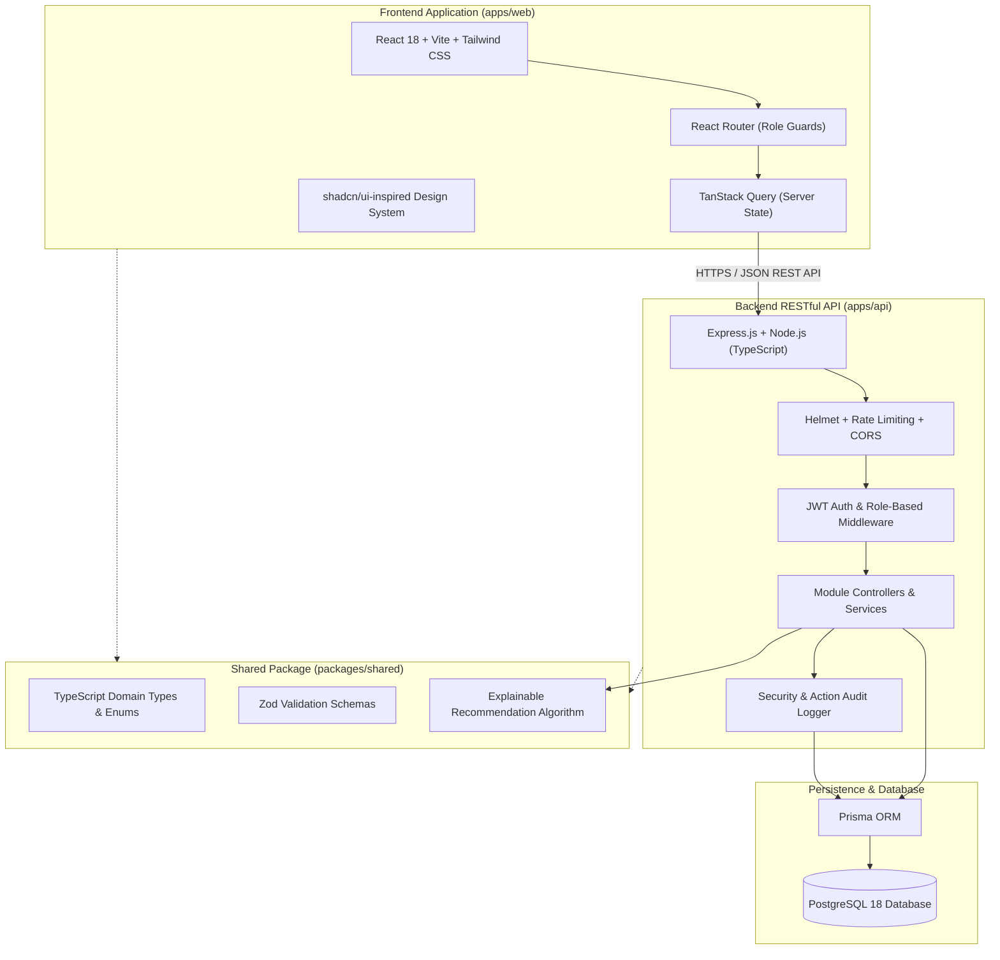

# MentorConnect — System Architecture Documentation

## 1. Executive Summary
**MentorConnect** is a full-stack, enterprise-grade web application engineered for colleges and universities to administer, track, and optimize student–faculty mentoring relationships. The platform supports three core roles: **Mentee (Student)**, **Mentor (Faculty)**, and **Administrator (Head of Department / HOD)**.

---

## 2. System Architecture Overview

---

## 3. Monorepo Organization
The repository employs npm workspaces for strict separation of concerns:

- `apps/web`: Single-Page Application (SPA) built with React 18, Vite, TypeScript, Tailwind CSS, Lucide icons, and Recharts.
- `apps/api`: RESTful API server built with Express.js, TypeScript, Prisma, and JWT token authentication.
- `packages/shared`: Universal domain models, Zod validation schemas, and explainable matching criteria shared across frontend and backend.
- `prisma`: PostgreSQL schema definitions, migrations, and realistic seed data generators.
- `tests`: Automated integration test suite leveraging Vitest and Supertest.
- `prompts`: Verbatim record of all engineering prompts and development specifications.
- `docs`: Detailed technical specifications and evaluation checklists.

---

## 4. Key Architectural Decisions
1. **Explainable Mentoring Algorithm**: Instead of an opaque "black-box" model, the recommendation engine computes a 0–100% compatibility score based on transparent, configurable weights (Department, Domain Expertise, Technical Skills, and Faculty Capacity Margin).
2. **Strict Server-Side RBAC**: Role restrictions and resource ownership are verified at the controller level; client-side UI visibility controls are purely UX conveniences.
3. **Data Relational Integrity**: Historical assignment tracking is preserved through assignment status transitions (`ACTIVE`, `REASSIGNED`, `COMPLETED`), preventing loss of mentorship records.
4. **Audit Trail Persistence**: Destructive and critical administrative actions (assignments, reassignments, account toggles, and status updates) are persisted with IP address, actor, and timestamp.
