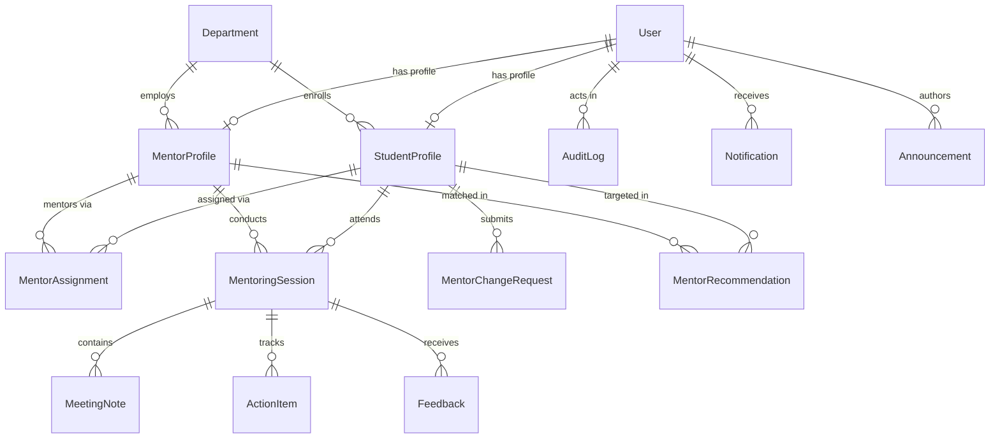

# MentorConnect — Database Design & Schema Specification

## 1. Relational Entity Overview
The database is modeled as a normalized PostgreSQL relational database managed through Prisma ORM.

---

## 2. Core Entities & Constraints

### A. User (`User`)
- `id` (UUID, Primary Key)
- `email` (VarChar, Unique, Indexed)
- `passwordHash` (Bcrypt salted hash)
- `role` (Enum: `STUDENT`, `MENTOR`, `HOD`)
- `isActive` (Boolean, Default: `true`)
- `lastLogin` (Timestamp, Nullable)

### B. StudentProfile (`StudentProfile`)
- `id` (UUID, Primary Key)
- `userId` (UUID, Foreign Key -> `User.id`, Unique, OnDelete: Cascade)
- `usn` (VarChar, Unique, Indexed) — University Seat Number
- `fullName` (VarChar)
- `departmentId` (UUID, Foreign Key -> `Department.id`)
- `semester` (Integer, 1 to 8)
- `degree` (VarChar, Default: `B.E.`)
- `section` (VarChar, Nullable)
- `technicalSkills` (VarChar Array)
- `careerGoals` (VarChar Array)
- `guidanceNeeds` (VarChar Array)
- `preferredTopics` (VarChar Array)
- `hobbies` (Text, Nullable)
- `bio` (Text, Nullable)
- `profileCompleted` (Boolean, Default: `false`)

### C. MentorProfile (`MentorProfile`)
- `id` (UUID, Primary Key)
- `userId` (UUID, Foreign Key -> `User.id`, Unique, OnDelete: Cascade)
- `facultyId` (VarChar, Unique, Indexed)
- `fullName` (VarChar)
- `designation` (VarChar)
- `departmentId` (UUID, Foreign Key -> `Department.id`)
- `expertise` (VarChar Array)
- `technicalSkills` (VarChar Array)
- `mentoringInterests` (VarChar Array)
- `bio` (Text, Nullable)
- `maxCapacity` (Integer, Default: 10)
- `currentMenteeCount` (Integer, Default: 0)

### D. MentorAssignment (`MentorAssignment`)
- `id` (UUID, Primary Key)
- `studentId` (UUID, Foreign Key -> `StudentProfile.id`, Indexed)
- `mentorId` (UUID, Foreign Key -> `MentorProfile.id`, Indexed)
- `academicTermId` (UUID, Foreign Key -> `AcademicTerm.id`, Nullable)
- `status` (Enum: `ACTIVE`, `REASSIGNED`, `COMPLETED`, Indexed)
- `assignedBy` (VarChar, HOD name / identifier)
- `notes` (Text)
- `assignedAt` (Timestamp, Default: `now()`)
- `endedAt` (Timestamp, Nullable)

### E. MentoringSession (`MentoringSession`)
- `id` (UUID, Primary Key)
- `title` (VarChar)
- `studentId` (UUID, Foreign Key -> `StudentProfile.id`, Indexed)
- `mentorId` (UUID, Foreign Key -> `MentorProfile.id`, Indexed)
- `scheduledAt` (Timestamp, Indexed)
- `durationMinutes` (Integer, Default: 30)
- `meetingType` (Enum: `IN_PERSON`, `VIRTUAL`, `HYBRID`)
- `location` (VarChar, Nullable)
- `meetingLink` (VarChar, Nullable)
- `agenda` (Text)
- `status` (Enum: `SCHEDULED`, `COMPLETED`, `CANCELLED`, `RESCHEDULED`, Indexed)

### F. MeetingNote (`MeetingNote`)
- `id` (UUID, Primary Key)
- `sessionId` (UUID, Foreign Key -> `MentoringSession.id`, Cascade)
- `authorId` (UUID, Foreign Key -> `User.id`)
- `visibility` (Enum: `PRIVATE_MENTOR`, `SHARED_STUDENT`, `SHARED_HOD`)
- `content` (Text)

---

## 3. Relational & Historical Integrity Rules
1. **Duplicate Assignment Prevention**: Application logic and database queries ensure a student cannot possess multiple simultaneous `ACTIVE` assignments.
2. **Soft Deactivation & Record Preservation**: User deactivation updates `isActive = false`, retaining all mentoring notes and session history intact.
3. **Foreign Key Restraints**: Core academic records use `onDelete: Restrict` or `SetNull` to prevent cascading accidental data purges.
